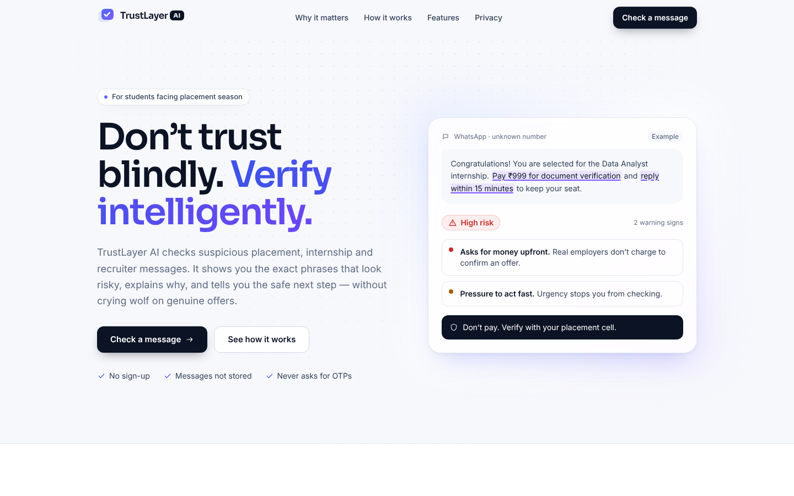

# TrustLayer AI

**Don't trust blindly. Verify intelligently.**

TrustLayer AI helps students check suspicious placement, internship and recruiter messages. Paste an email,
SMS or WhatsApp message and see a risk level, the exact phrases that look risky, why they matter, and the
safe next step — without false alarms on genuine offers.

Built for the Arthakram Rapid Prototyping Hackathon (PS 5 — "The Fake HR Email").

> **Status:** Phase 1 — frontend complete with **mock (demonstration) results**. The backend and AI analysis
> are not built yet. Every result in the UI is labelled "Demonstration data".



## Repository structure
```
TrustLayer-AI/
├── CLAUDE.md · README.md · PRODUCT_SPEC.md · ARCHITECTURE.md · API_CONTRACT.md
├── SECURITY_AND_PRIVACY.md · RISK_RULES.md · TEST_PLAN.md · TEAM_WORKFLOW.md · CHANGELOG.md
├── frontend/      Next.js App Router + TypeScript + Tailwind (owner: Antriksh)
├── backend/       FastAPI service — placeholder, Phase 3 (owner: Darsh)
├── research/      Fictional sample messages + detection research (owner: Kushagri)
├── docs/          Screenshots, architecture notes, demo material
└── .github/       Issue templates + pull request template
```

## Prerequisites
- Node.js **20.9+** (LTS recommended) and npm 10+
- Git
- Python 3.11+ (only needed from Phase 3, for the backend)

## Run the frontend locally
```bash
git clone https://github.com/Antrikshcodes/Trustsheild-AI.git
cd Trustsheild-AI/frontend
npm install
cp .env.example .env.local     # optional — defaults to demo mode
npm run dev
```
Open http://localhost:3000.

### Useful scripts (run inside `frontend/`)
| Command | What it does |
|---|---|
| `npm run dev` | Start the dev server |
| `npm run build` / `npm start` | Production build / serve it |
| `npm run lint` | ESLint |
| `npm run typecheck` | TypeScript, no emit |
| `npm run check` | Lint + typecheck + build — run before every PR |
| `npm run format` | Prettier |

### Environment variables (`frontend/.env.local`)
| Variable | Default | Purpose |
|---|---|---|
| `NEXT_PUBLIC_ANALYZER_MODE` | `demo` | `demo` = in-browser mock; `api` = call the backend (Phase 3+) |
| `NEXT_PUBLIC_API_BASE_URL` | `http://localhost:8000` | Backend URL when mode is `api` |

Never put API keys in frontend env files — anything prefixed `NEXT_PUBLIC_` is visible to users.

## Using the app
1. Click **Check a message** or scroll to the analyzer.
2. Pick where you received it (Email / SMS / WhatsApp / Other), paste the text, optionally add the sender.
3. Click **Analyze Message**, or try one of the four fictional examples.
4. Read the risk level, highlighted phrases, warning cards and safe next steps.

Tip for demos: add `?demoError=1` to the URL to preview the error state.

## Contributing
Read [TEAM_WORKFLOW.md](TEAM_WORKFLOW.md) and [CLAUDE.md](CLAUDE.md). In short: never commit to `main`, work on
a `feat/...` or `fix/...` branch, run `npm run check`, open a PR with the template, get one review.

## Team
Antriksh (frontend + product) · Darsh (backend) · Kushagri (R&D + QA) · Teammate 4 (AI integration + DevOps)

## Limitations
TrustLayer provides automated warning signals for educational and safety assistance. It cannot guarantee
that a message is genuine or fraudulent. Verify important opportunities independently through official
channels. Never share passwords, OTPs or payment credentials.
